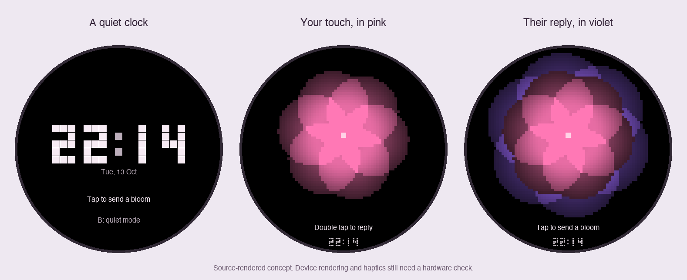
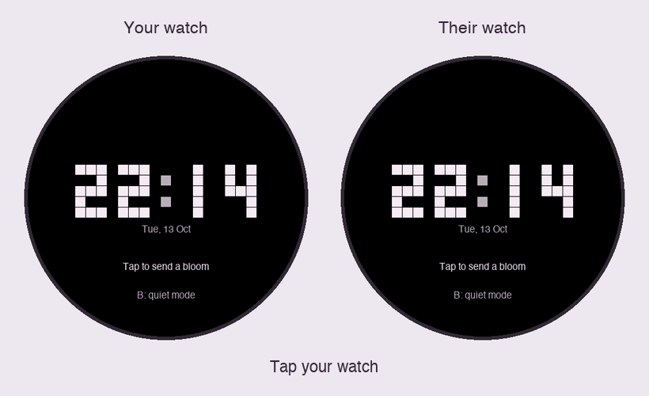

# Bloom

[All apps](../README.md)

A quiet connection between two M5Stack StopWatch badges, even in different countries.
Each badge connects to its own **2.4 GHz Wi-Fi with internet access**. A private HTTPS
relay passes touches between the two. No shared Wi-Fi, phone app, or inbound router
port on either badge is needed.



Source-rendered preview: the petals and pixel clock use the firmware's drawing code;
supporting text is illustrative. This is not a device capture.

## The interaction

| Action | What happens |
| --- | --- |
| Tap the screen or click A | The partner receives a pink, pixelated bloom with three soft breathing haptic cues. |
| Double tap the screen or double click A | Replies to the most recent incoming bloom with violet petals behind pink on the original sender's badge. Without a pending bloom, sends one pink bloom. |
| Wait | After 10 seconds, the bloom fades into the local clock. The reply gesture remains available for 2 minutes after receipt. |
| Press B | Toggles quiet mode: animations continue, vibration stops immediately. Resets on reboot. |

One tap waits 360 ms to distinguish it from a double tap. Holding or dragging does
not send a touch. A successful send gives a small, faint local echo unless an
incoming animation is already playing. Confirmation means **accepted by the relay**,
not seen by the other person. There are no read receipts or response counters.

The clock dims after 30 seconds without activity; an incoming bloom wakes its brightness.
This version stays awake and connected. It is a prototype, not optimized for all-day battery life.

## Build the firmware

Use the toolchain already installed for the other badge apps, or run
`./scripts/setup.sh` from the repository root to install the pinned versions.

```sh
cp bloom/secrets.example.h bloom/secrets.h
chmod 600 bloom/secrets.h
```

Edit `bloom/secrets.h` with this badge's Wi-Fi, public relay origin, its device token,
and the PEM root CA for the relay's HTTPS certificate. Set its local POSIX time zone in
`bloom/config.h`. Each badge uses its own Wi-Fi, token, and time-zone configuration;
both use the same relay origin and CA. Do not share or commit `secrets.h`.

```sh
./scripts/build-app.sh bloom
./scripts/test.sh
```

Output is in `build/bloom/`. Rebuilding for the second badge replaces these build
outputs, so save the first badge's build in a separate private folder before changing
credentials. Building without `secrets.h` succeeds with a setup screen and **no network
connection**; those example binaries cannot exchange touches.

`BLOOM_REDUCED_MOTION = true` in `config.h` makes the petals stationary, retaining
the fade and haptics. B independently controls haptics.

No upload is performed. Follow the shared [installation and recovery guidance](../README.md#installation-and-recovery)
before replacing an existing app. The init() partition table is preserved, and Bloom
does not mount or format the badge's profile storage.

## Set up the internet relay

For the hosted option, use **Railway Hobby** with one service and a persistent
volume. Its $5/month minimum includes $5 of usage; usage above that is billed
additionally. This is a recommendation, not a provisioned service or a guaranteed
monthly total. Pricing checked October 13, 2026: [Railway plans](https://docs.railway.com/pricing/plans).
Railway supplies [HTTPS and a hostname](https://docs.railway.com/networking/public-networking).

### Railway deployment

Deployment files are in `bloom/relay/`. After connecting Railway:

1. Create one service from the repository and set its **Root Directory** to
   `/bloom/relay`. Use the Dockerfile builder and the included `railway.json`
   (set its config path to `/bloom/relay/railway.json` when deploying the full repository).
2. Attach a **persistent volume at `/data`**. The database lives at `/data/bloom.sqlite3`.
   Use one replica, with sleeping/serverless mode disabled. Do not replace the volume
   with ephemeral container storage.
3. Generate the two tokens as described below and set service variables `BLOOM_TOKEN_A`
   and `BLOOM_TOKEN_B`. Tokens are runtime secrets, never Docker build arguments.
4. Deploy, then generate a Railway domain pointing to the service's `PORT` (8080 by
   default in the Dockerfile). `/healthz` returns `{"ok":true}` after startup.
5. Use that HTTPS origin and its root CA in the two badge builds. Review Railway's
   usage estimate after testing. No purchased domain or separate database service is needed.

The Docker entrypoint uses `--behind-https-proxy`: TLS terminates at Railway's
edge, and the private container receives HTTP. Use this mode only behind a trusted
HTTPS proxy; the badge still requires and validates HTTPS. For another host, the
same container works with a persistent `/data` volume and a trusted HTTPS proxy.

The Docker recipe and Railway deployment have not been run here; the Python relay
and health endpoint are covered by local integration tests. [Docker deployment docs](https://docs.railway.com/builds/dockerfiles)
and [volume docs](https://docs.railway.com/volumes) describe the platform settings.

### Self-hosted deployment

The relay supports **one pair per instance**. Run it on an always-on machine with
a public HTTPS hostname and persistent storage. Python 3.9+ is sufficient; no third-party
runtime packages are required. The relay terminates encryption and can see event types
and timestamps; this is TLS transport encryption, not end-to-end encryption.

1. Generate two independent device tokens with `python3 -c 'import secrets; print(secrets.token_hex(32))'`.
   Save them securely as `BLOOM_TOKEN_A` and `BLOOM_TOKEN_B` in the server's environment.
   Put only A's token in badge A, and only B's token in badge B. Tokens identify the two
   roles; there is no discovery service or guessable pairing PIN.
2. Start the relay from the repository root:

   ```sh
   python3 bloom/relay/server.py --database /private/path/bloom.sqlite3
   ```

3. Put an HTTPS reverse proxy on the **same server**, forwarding `/v1/exchange` to
   `127.0.0.1:8787`. Preserve the `Authorization` header, use a valid certificate for
   the public hostname, and keep the database on persistent disk. Run under a process
   supervisor so the service restarts after a reboot. Configure normal request limits
   at the proxy; the Python server is intended for a private two-device prototype.
4. Set `BLOOM_RELAY_URL` to that HTTPS origin (no trailing slash), and place its root
   CA PEM in `BLOOM_ROOT_CA`. The firmware validates the certificate and hostname;
   it waits for NTP time before connecting. Check Wi-Fi/NTP access if it stays on
   “Setting the clock”; check origin/CA/certificate if it stays on “Reconnecting to relay”.

For an existing TLS certificate and private key, a direct listener is also supported:

```sh
python3 bloom/relay/server.py --bind 0.0.0.0 --port 8443 \
  --cert /private/path/fullchain.pem --key /private/path/privkey.pem \
  --database /private/path/bloom.sqlite3
```

Use the matching `https://hostname:8443` origin in this case. Plain HTTP listeners
default to loopback; non-loopback HTTP requires the explicit proxy mode above.
Never expose the HTTP relay port directly to the internet.
Rotate the tokens in the server environment and rebuild both badges when changing pairs;
start with a fresh database to discard the previous pair's messages.

## Delivery behavior

- A background task polls about once per second while connected. Network operations
  do not block drawing, touch handling, or turning the motor off. Actual latency depends
  on Wi-Fi and the distance to the relay; delivery is not simultaneous or real-time guaranteed.
- Each event has a random ID. Retries with the same ID are idempotent, and an incoming
  event stays queued until the recipient acknowledges it. SQLite survives relay restarts.
- Undelivered touches expire after **60 seconds**. Four pending events per direction
  and a 2-second send interval bound bursts. Old touches do not turn into a stream of
  vibrations when someone reconnects much later. At most 10 minutes of event metadata
  is retained, cleaned up on subsequent requests.
- A reply references a specific incoming bloom. The server checks its direction, age
  (under 3 minutes), and that it has not already received a reply. Replies cannot trigger
  an endless chain of replies. Crossing blooms remain independently valid.
- Outgoing retries stop after 15 seconds without confirmation. “Could not confirm delivery”
  means the result is uncertain: the server may have received a request whose response
  was lost. Offline taps are not silently queued for later.
- Incoming duplicate suppression and the reply gesture live in RAM. Rebooting a badge
  clears the reply window. A power loss between displaying and acknowledging a message
  can display that still-fresh message again; delivery is at least once, not exactly once.

## Design and preview

Black `#000000` leaves the AMOLED quiet. Pink `#FF78B5` is a touch, rose `#FFD2E6`
is the center, violet `#9564EF` is the reply, white `#F7EBF4` carries the clock, and
muted lavender `#BCAEBB` carries hints. The petals are the only animated focus.
Six overlapping circles breathe on a 6-pixel grid; a 3×5 bitmap clock echoes their texture.
Native Font2 and Font4 keep the supporting labels readable. The face has no title
or message heading; larger petals fill the upper display, with hints and a small
clock beneath. The idle clock also uses larger digits within the 466×466 circular screen.

```text
      [large pixel petals]
       Double tap to reply
              22:14
```

The design uses the brief's pink and violet in the petals, with no extra decorative
panels or app chrome. To regenerate the source previews, install Pillow in your
preview environment and run `python3 scripts/preview-bloom.py`.

The animated exchange shows the pink bloom arriving on the partner's watch,
the violet reply returning to the sender, and both faces settling into their clocks.



## Verification

`scripts/test.sh` checks single/double taps, duplicate receipt, delayed replies,
crossing blooms, timer rollover, motor cutoff, drawing bounds, preserved partitions,
authentication, invalid inputs, rate/queue limits, expiry, durable retries, and an HTTP
round trip between independent clients. These do not require badge hardware.

Before using the pair, check on two devices connected to different internet networks:

1. Tap A; only B should show pink and vibrate. Double tap B; A should receive violet
   behind pink. Both return to their own local clocks.
2. Reverse roles, then send simultaneous blooms. Confirm replies go to the right bloom.
3. Press B during a vibration; the motor should stop while the animation continues.
4. Disconnect B briefly and reconnect within 60 seconds; a pending bloom should arrive.
   Repeat after more than 60 seconds; the old bloom should have expired.
5. Check the clock/time zone, reconnect after a router restart, and measure battery life.

Physical touch timing, motor feel, display frame rate, public TLS connectivity,
cross-region latency, and battery runtime need hardware/deployment validation.

Hardware reference: [M5Stack StopWatch documentation](https://docs.m5stack.com/en/core/StopWatch).
