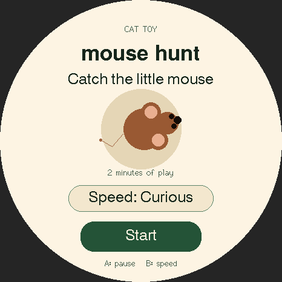

# Cat Toy

[All apps](../README.md)

A quiet, offline **catch-the-mouse** game. A little mouse scurries, pauses, and
changes direction around the circular screen. A paw tap near the mouse counts
as a catch and sends it to a new position.

## Preview



Source-rendered preview with sample data; not a device photograph.

## Design

Cat Toy’s **Mouse Hunt** game uses warm cream, forest-green pill buttons, and a
brown mouse with peach ears. The menu shows a larger illustration; play keeps the
original mouse size and catch area on a clear cream field. Colors live in
[design.h](design.h). There are no decorative moving targets during play.

## Build

Requires Arduino CLI (or Arduino IDE on macOS). Install the pinned tools with
`./scripts/setup.sh`, then run from the repository root:

```sh
./scripts/build-app.sh cat_toy
./scripts/test.sh
```

Shared checks require C++17 and Python 3; see [check coverage](../README.md#development).
The firmware build itself needs no Python packages.

Firmware goes to `build/cat_toy/`. No upload is performed. Read the shared
[installation guidance](../README.md#installation-and-recovery) before flashing.

## Controls

| Control | Action |
| --- | --- |
| Start / Resume | Begin or resume a two-minute active-play session. |
| Paw tap near the mouse | Count one catch per touch and move the mouse away. |
| Physical A | Pause/resume. Touching empty play space does not open menus. |
| Physical B | Cycle Slow, Curious, and Fast movement. |
| Speed button while paused | Change movement speed. |
| Play again after All done | Start a fresh session and reset catches. |

The session clock pauses while paused. At two minutes it stops automatically.
There is no sound, vibration, recording, networking, or saved history. Restarting
the badge resets the game.

Place the badge flat on a stable surface, keep its strap/cable out of the play
area, and supervise. Paw detection depends on the touchscreen; follow the screen
session with a physical toy the cat can catch.

## Verification

App-specific automated tests are not included. Check catches, speed changes,
pause/resume, session completion, and restart on the badge.

Not verified: actual cat-paw touch response, behavior during play, and battery
runtime. Human touch can check catches and controls before supervised cat play.
