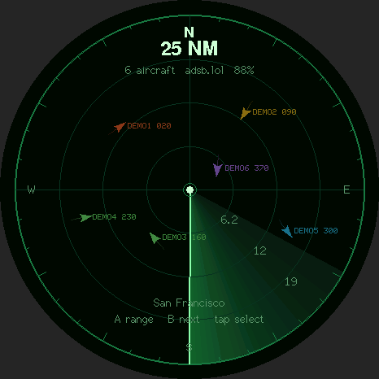

# Flight Radar

[All apps](../README.md)

Live aircraft radar for the M5Stack StopWatch, centered on a configurable location.
The default is an example location in San Francisco.

## Preview



Source-rendered preview with sample data; not a device photograph.

## Controls

- Animated green radar with heading markers, trails, and altitude colors.
- Live aircraft from adsb.lol, with adsb.fi as a backup; at least 10 seconds between requests.
- Yellow **A** cycles 5 / 10 / 25 / 50 / 100 nautical miles.
- Blue **B** selects the next nearest visible aircraft. Tap a marker for details;
  tap empty space to clear the selection.
- Vibration when an already tracked aircraft crosses into the inner range ring.
- Emergency squawks pulse red. Aircraft positions expire after 60 seconds;
  movement between updates is an estimate capped at 45 seconds.

## Build

Requires Arduino CLI (the copy bundled with Arduino IDE on macOS also works).
Shared checks require C++17 and Python 3.

Run these commands from the repository root:

```sh
./scripts/setup.sh
# Edit flight_radar/secrets.h with your 2.4 GHz Wi-Fi SSID and password.
./scripts/build-app.sh flight_radar
./scripts/test.sh
```

Setup uses a project-local `.arduino/` directory and preserves your global Arduino
configuration. It pins M5Stack core 3.3.9, M5Unified 0.2.25, M5GFX 0.2.32, and
ArduinoJson 7.4.3. Initial downloads require several GB of disk space.

Edit `flight_radar/config.h` to change the example San Francisco radar center.
This build uses fixed coordinates; it does not scan and upload nearby Wi-Fi
access points.
Aircraft providers receive the configured coordinates and your public IP.
HTTPS verifies ISRG Root X1 / GTS Root R4; network time is synchronized before
the first request. A network blocking NTP can leave the badge waiting for its clock.

Without Wi-Fi credentials, the firmware builds but displays a setup message.
Keep `secrets.h` and generated binaries private: configured binaries contain your
Wi-Fi credentials. Review changes to `config.h` before committing if your radar
center is private. Build output is saved in `build/flight_radar/`.

See [installation and recovery](../README.md#installation-and-recovery) before
flashing. Building does not upload firmware.

## Checks and limits

App-specific automated tests are not included; see [available checks](../README.md#development).
Check live feed updates, range changes, aircraft selection, and Wi-Fi reconnection
on the badge. The Arduino build reports the compiled app's size against its slot.

The radar keeps up to 128 valid positions from each response and uses a local
projection appropriate to these ranges. Free feeds can omit aircraft or be delayed
or unavailable. This is a hobby display, not a navigation instrument.

Screen rendering, touch, vibration, battery life, and Wi-Fi/TLS on the physical
badge require a device test after installation.

USB status messages report feed health without credentials.
