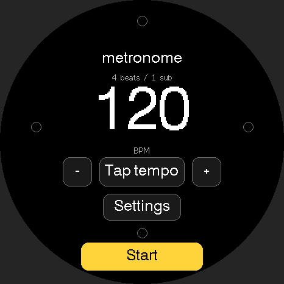

# Metronome

[All apps](../README.md)

An offline practice metronome with tap tempo, a circular beat display, optional
speaker clicks, and vibration. It starts stopped at **120 BPM, 4 beats per bar**,
with main-beat vibration enabled and sound off.

## Preview



Source-rendered preview with sample data; not a device photograph.

## Build

Requires Arduino CLI (or Arduino IDE on macOS). Install the pinned tools with
`./scripts/setup.sh`, then run from the repository root:

```sh
./scripts/build-app.sh metronome
./scripts/test.sh
```

Shared checks require C++17 and Python 3; see [check coverage](../README.md#development).
The firmware build itself needs no Python packages.

Firmware goes to `build/metronome/`. No upload is performed. Read the shared
[installation guidance](../README.md#installation-and-recovery) before flashing.

## Controls

| Control | Action |
| --- | --- |
| Tap tempo or physical A | Tap at least twice to set tempo; successive taps average up to four intervals. |
| − / + | Decrease/increase tempo by 1 BPM, within 30–240 BPM. |
| Start / Stop or physical B | Start or stop immediately. Starting begins a new bar. |
| Settings → Beats / bar | Cycle through 1–7 beats per bar. |
| Settings → Subdivisions | Cycle through 1, 2, 3, or 4 equal subdivisions per beat. |
| Settings → Sound | Toggle speaker clicks. The downbeat has a higher pitch. |
| Settings → Buzz | Toggle vibration on the main beats; the downbeat is stronger. |

Large ring markers represent main beats and small markers represent subdivisions.
The current tick fills white. Visual timing stays on when sound and vibration are
off. Yellow marks the primary Start/Stop or Done action. Tempo uses fixed-width
numerals so it stays still while changing.

Changing tempo, beats, or subdivisions restarts the bar. Changing sound or vibration
does not. A tap gap longer than two seconds resets the tap estimate; taps less than
250 ms apart are ignored. Subdivisions have visual and audible cues; vibration
marks only the main beats because short motor pulses would blur together.

## Timing and limits

A separate FreeRTOS task schedules output independently of screen drawing. It
uses the elapsed microsecond clock to derive beat positions without accumulating
rounded interval drift. Delayed ticks skip to the current position instead of
playing a burst of missed beats. The motor switches off after each 35 ms pulse.

The microphone and Wi-Fi are unused. Settings reset on restart. Audio failure is
shown in Settings while visual/vibration modes remain available.

App-specific automated tests are not included. Check tap tempo, beat/subdivision
changes, pause/restart, and switching sound and vibration on the badge.

Not verified: physical speaker/motor onset latency, scheduler jitter under device
load, audible levels, and battery runtime. Compare the actual clicks with a
reference metronome at 30, 120, and 240 BPM before relying on precision timing.
