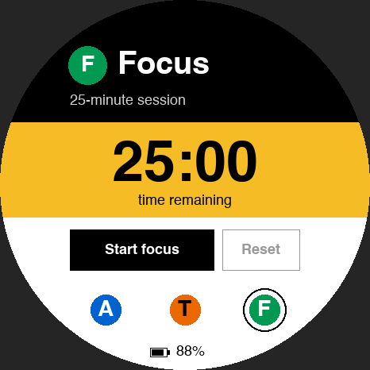

# Pulse Station

[All apps](../README.md)

Native firmware for the M5Stack StopWatch with a subway-inspired interface:
white face, black header, MTA route colors, Helvetica, and a black ring
around the selected mode. The default mode is **Focus**.

## Preview



Source-rendered preview with sample data; not a device photograph.

## Controls

- Tap **Start focus** for 25 minutes; **Pause**, **Resume**, and **Reset** work on-device.
- The timer continues when you switch modes. Completion returns to Focus and
  vibrates once. Turning the badge off or restarting resets the timer.
- Tap the **A / T / F** route buttons to switch modes. Physical **A** cycles modes;
  physical **B** opens Agents outside Talk, or records while held in Talk.
- The bottom percentage comes from the badge's battery voltage through M5Unified.
  It is a charge estimate; unavailable readings show `--%`.
- **Talk**: hold its yellow panel or the blue **B** button, wait for
  the red **Listening** state, then speak. Release to transcribe. When the badge
  says **Ready to paste**, press **Cmd+V** in the current Codex chat.
- **Agents** still shows a disconnected state. No sample task data is presented
  as live information.

## Hold to talk

Build and run the [Mac companions](../mac/README.md) with the badge connected by
USB. They transcribe locally and copy the result to the clipboard for pasting.

Recording requires a live Mac heartbeat, is limited to 30 seconds, and stops on
release, mode change, or connection loss. Mode changes discard an active recording.
Allow about 1.2 seconds for the microphone to warm up; the red screen indicates it
is ready for speech. Focus continues while you dictate.

The transcript is **not automatically inserted or submitted**. Paste it into
your chosen app and review the text.

## Build

Requires macOS, Arduino CLI (or the copy bundled with Arduino IDE), Python 3,
and the installed Helvetica font. Host checks also require a C++17 compiler.
Run these commands from the repository root:

```sh
python3 -m venv .venv
source .venv/bin/activate
python3 -m pip install Pillow
./scripts/setup.sh
./scripts/build-app.sh pulse_station
./scripts/test.sh
```

Setup installs the pinned Arduino tools into `.arduino/` without changing your
global Arduino configuration. Initial downloads require several GB of disk space.
Pulse uses the same partition layout as the radar. Font generation uses Pillow and
`/System/Library/Fonts/Helvetica.ttc`. Generated glyphs stay in the ignored
`pulse_station/helvetica_generated.h`; builds stay private in `build/pulse_station/`.
Pulse does not use Wi-Fi, mount conference storage, or embed Wi-Fi credentials.
Installing it replaces the radar application; the radar remains rebuildable.

## USB verification

At 115200 baud, newline-terminated `status` reports the running app partition,
mode, timer, actual battery reading, board, PSRAM, and free heap. `tap X Y` sends
a bounded coordinate through the touchscreen handler. `frame` returns
`PULSE_FRAME 434312` followed by the 466×466 RGB565 framebuffer (big-endian pixels).
Command acknowledgments use `PULSE_REPLY`; periodic telemetry uses `PULSE_STATUS`.
Periodic status lines may precede a response. Only one program can own the serial
port at a time.

Talk adds `bridge ready` (renew every two seconds), `bridge offline`, `hold`, and
`release`. `hold`/`release` are diagnostics for the same recording functions used
by the physical controls. On release, `PULSE_AUDIO <session> <bytes>` is followed
by exactly that many bytes of 16 kHz, mono, little-endian signed 16-bit PCM and a
newline. The host replies `voice <session> ready|empty|permission|error`. Stale
results are ignored. Capturing pauses framebuffer diagnostics to keep audio
continuous. The microphone stops before transcription starts.

App-specific automated and USB device test scripts are not included; see
[available checks](../README.md#development). USB-injected touches exercise the
firmware's input handler, not the physical touch sensor. Check pause/resume,
reset, completion, physical controls, vibration, and battery runtime on the badge.

Speak near the badge and review the transcript; quiet speech can be misheard.
Check a short recording, silence, disconnect/reconnect, and a full 30-second
recording with the [Mac companions](../mac/README.md) before relying on Talk.

See [installation and recovery](../README.md#installation-and-recovery) before
flashing. No device backups or installation records are distributed.
