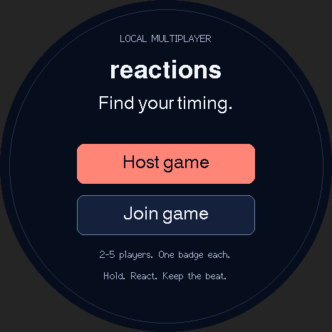

# Reactions

[All apps](../README.md)

A local party game for **2–5 players, each with a StopWatch**. One badge hosts
and chooses each round's challenge. The host plays as Player 1.

## Preview



Source-rendered preview with sample data; not a device photograph.

## Design

A navy arcade face with coral primary buttons. Mint marks connected players,
the GO cue, and first-place results. Results separate rank, player, and timing
into columns; the shaded row and `*` identify your badge. Room PINs use fixed-width
digits. Colors and control styling live in [design.h](design.h).

## Build

Requires Arduino CLI (or Arduino IDE on macOS). Install the pinned tools with
`./scripts/setup.sh`, then run from the repository root:

```sh
./scripts/build-app.sh reactions
./scripts/test.sh
```

Host tests require a C++17 compiler, Python 3, and `pyserial` installed in your
Python environment. The firmware build itself needs no Python packages.

Firmware goes to `build/reactions/`. No upload is performed. Read the shared
[installation guidance](../README.md#installation-and-recovery) before flashing.

## Create or join a game

1. On one badge, tap **Host game**. It displays a room ID and a six-digit PIN.
2. On every other badge, tap **Join game**, select that room, and enter the PIN.
   **Del** removes a digit; **Go** connects. The host counts toward the five-player limit.
3. Filled player circles show connected badges. Players receive numbers automatically.
4. On the host, tap the challenge or press **A** to cycle challenges. Tap
   **Start round** or press **B** once at least two players are present.
5. Release the controls during the readiness check. Wait for **GO** on your own badge.

The host creates a temporary WPA2 Wi-Fi network. There is no router, internet,
phone, cloud service, or saved home Wi-Fi credential. The room list shows up to
four nearby rooms; use **Scan again** if needed. The PIN changes when a new room
is created. Stay within the host badge's Wi-Fi range.

## Challenges and controls

Use the physical **B** button or the **B / Touch** pad for the challenge.
Use the same input method for the start and end of a hold.

| Challenge | What to do after GO | Scoring |
| --- | --- | --- |
| Hold 2 seconds | Hold, estimate two seconds without a visible timer, then release. | Smallest absolute error from 2,000 ms wins. |
| Quick draw | Press as soon as GO appears. | Shortest response time wins. |
| Match 500 ms | Tap twice, aiming for half a second between taps. | Smallest absolute error from 500 ms wins. |

Pressing before GO is a false start. A held control at the cue, missing response,
or disconnected player receives **No score**. Equal millisecond scores share a
rank. Results are for the current round; the host taps **Next round** to choose
again. **A** leaves a guest's lobby/results, goes back during setup, or closes
the host's room from the results screen. It cycles challenges in the host lobby.

## Timing and connection behavior

Each badge measures its own input interval. Quick draw starts timing after its
GO frame has been sent to the display, rather than using network arrival time
as a score. Cues can appear at slightly different times on different badges.
Physical scan, display, and touch latency still affect scores; this is a casual
party game rather than calibrated competition timing.

The host waits for all players to acknowledge preparation. If a badge does not
acknowledge within four seconds, the round returns to the lobby. State and pending
results are retried every 100 ms. Session, round, peer address, token, and state
sequence checks reject unrelated or stale messages. Leaving players expire after
five seconds; guests return to an error screen after losing the host.

Scores are self-reported by the paired firmware. The room PIN controls access,
but this is not an anti-cheat system for modified badges. No names, addresses,
PINs, or scores are saved to device storage.

## Verification

Host tests cover 2–5-player room limits, readiness, ties, false starts, hold and
tap timing, clock wrap, stale results, disconnect/round timeouts, and malformed
packets. The firmware compiles with the preserved init() partition layout.

Not verified: live play across multiple badges, wireless range, touch/button
latency, and battery runtime. For a device check, join two badges, run all three
challenges, repeat with five, and disconnect a guest during preparation and play.
